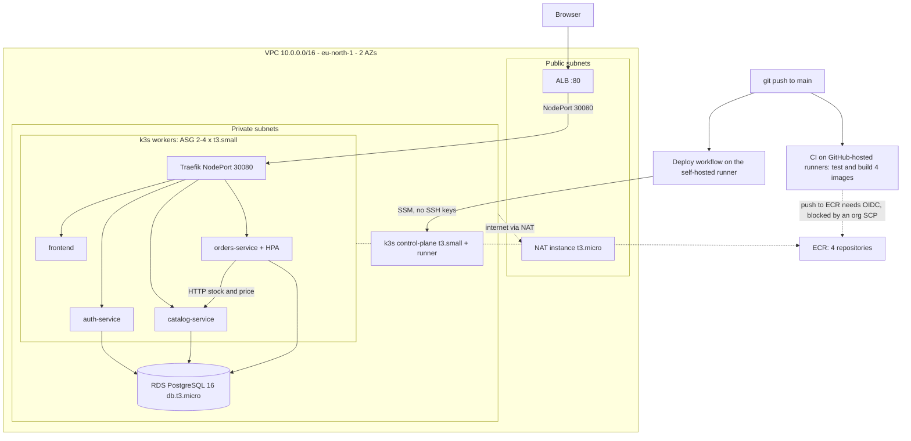

# Architecture Diagram

The provided reference architecture is in [`aws-architecture.svg`](./aws-architecture.svg)
/ [`aws-architecture.png`](./aws-architecture.png) — also linked from the root
`README.md`. It depicts:

- GitHub Actions (CI on GitHub-hosted runners; CD on a self-hosted runner
  registered on the k3s control-plane instance) -> AWS via OIDC, no static keys
- VPC (10.0.0.0/16), public/private subnets across 2 AZs, Internet Gateway,
  NAT Instance (not a paid NAT Gateway)
- Self-managed k3s on EC2: one control-plane instance + an Auto Scaling Group
  of worker instances, all in private subnets, managed via SSM (no SSH keys,
  no public IPs)
- Application Load Balancer (public subnets, both AZs) -> NodePort on k3s
  nodes -> Traefik (bundled with k3s) -> ClusterIP Services -> pods
- orders-service -> catalog-service HTTP call (inter-service communication)
- Amazon RDS PostgreSQL (private subnets, RDS subnet group) — replaces the
  per-service SQLite files once you complete the migration in README §5.6
- 4 ECR repositories (auth, catalog, orders, frontend) and an S3 bucket for
  Terraform remote state + DB backups

If your actual implementation diverges from this reference (e.g. you changed
instance types, added a bastion, split subnets differently), update the
diagram to match what you actually built — it should describe your
deployment, not just the assignment's reference design.

---

## As built (this repository)

| Item | Reference design | As built |
|---|---|---|
| Region | not fixed | `eu-north-1`, two AZs |
| NAT | NAT instance | `t3.micro` NAT instance, `iptables` MASQUERADE |
| k3s nodes | not fixed | `t3.small` control-plane and workers (ASG 2 to 4) |
| Ingress | Traefik behind the ALB | Traefik pinned to NodePort `30080` |
| CI to AWS | GitHub OIDC, no static keys | OIDC module written but disabled: an AWS Organization SCP denies creating the OIDC provider. No static keys are used anywhere. |
| Images in ECR | pushed by CI | pushed by `scripts/deploy.sh`; `deploy.yml` falls back to `latest` |
| S3 | state and DB backups | state only (with a DynamoDB lock table); DB backups are not implemented |
